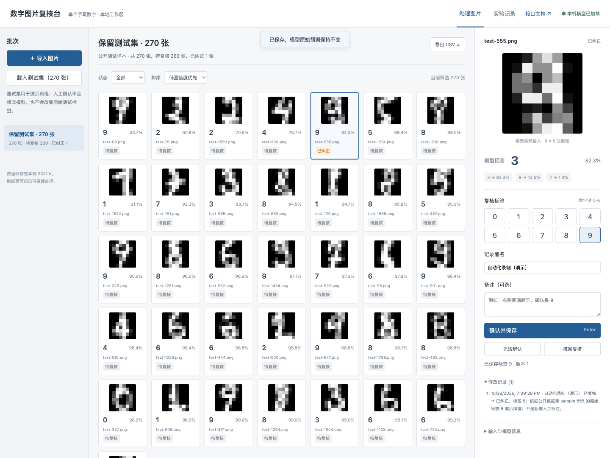

# 数字图片复核台

一个面向单个手写数字的本地处理工具：导入一批图片，由手写 PyTorch ResNet 预测，再按低置信度优先逐张核对。修改结果保存在 SQLite 中，可以追溯和导出。

项目从分类演示改造而来。主要改进在处理流程：保存上传原图，区分模型预测与确认标签，处理重复请求和同时修改，检查复核顺序是否有用。没有新增算法的主张。



## 启动

建议 Python 3.12；本次实际验证环境是 Intel macOS、CPU。模型权重随仓库保存，不需要 API 密钥。

```sh
python3.12 -m venv .venv
.venv/bin/python -m pip install -r requirements.txt
sh scripts/start.sh
```

打开 <http://127.0.0.1:8766>，接口文档在 `/docs`。先点“载入测试集”可检查流程，也可以导入自己的单数字 PNG / JPEG / WebP。白底黑字需要选择对应笔画颜色。

数据库默认位于 `var/review.sqlite3`，刷新或重启后仍保留。可以用 `REVIEW_DB` 指定另一个数据库。数据库不入库，其中可能有用户上传图片。服务只绑定本机；记录署名是填写的信息，不是经过认证的用户身份。

## 能完成什么

- 批量导入、原文件去重、预处理及模型推理；一批最多 40 张。
- 原图与 8×8 模型输入对照；低置信度优先、筛选和分页。
- 确认、纠正、无法辨认、撤回复核；每次修改保留前后状态、署名和时间。
- 版本冲突返回 409，避免后一次保存无声覆盖前一次；同一请求重试不产生第二条事件。
- CSV 同时保留原预测和最终标签；未复核项的最终标签为空。

## 实验结果与边界

原模型使用 scikit-learn 提供的 UCI Digits 子集：1797 张 8×8 图片。固定拆分为训练 988、验证 269、校准 270、测试 270 张。测试正确 267 张，准确率 98.89%；这不能代表手机拍照或扫描文档的表现。

复核队列沿用已经查看过的测试集，属于回顾性分析。每个场景检查前 20 张时：

| 场景 | 全部错误数 | 低置信度优先遇到的错误 | 1000 次随机顺序均值 |
|---|---:|---:|---:|
| 原始测试图 | 3 | 2 | 0.206 |
| 添加 σ=0.25 噪声 | 33 | 14 | 2.476 |
| 亮度乘以 0.5 | 70 | 16 | 5.106 |

噪声和亮度场景由程序变换已有图片得到，不是现场采集。这里测的是排序遇到错误的数量，没有测人工耗时或人工纠错成功率。原始图仍有一例高置信度错误不会排到前 20 张；低置信度优先不能保证找全错误。

## 检查与复现

```sh
.venv/bin/python -m pytest -q
.venv/bin/python -m scripts.review_experiment
.venv/bin/python -m src.train --output artifacts/run-002
```

训练命令拒绝覆盖已有目录。复核实验固定使用 `run-001`，会重写 `artifacts/review/` 下的实验结果文件。新训练不会自动替换服务模型。模型、划分和原始逐样本预测都保存在 `artifacts/run-001/`。

## 文档与演示

- [项目说明与设计复盘](docs/PROJECT_REPORT.md)：数据流程、关键取舍、验证和不足。
- [训练报告](docs/REPORT.md)：第一版训练与评估证据，保留原记录。
- [验收对应表](docs/ACCEPTANCE.md)、[代码理解与个人感悟准备](docs/DEFENSE.md)。
- [GitHub 调研笔记](docs/research/GITHUB_NOTES.md)、[队列实验协议](docs/research/REVIEW_PROTOCOL.md)、[参考与数据许可](docs/REFERENCES.md)。
- [运行视频](artifacts/review/demo/运行演示.mp4)：实际 Chrome 页面录制，34.8 秒，无音轨，操作由自动化脚本执行。演示纠错依据已有公开标签，署名为“自动化录制（演示）”。

复录需要安装 `requirements-demo.txt`，启动服务后执行 `.venv/bin/python scripts/record_workbench.py`。默认使用 macOS Chrome，可用 `CHROME_PATH` 指定路径；录制会向当前数据库增加演示批次。

## 开发记录

本项目使用 AI 辅助开发，不能用文档替代提交者本人对代码的理解。GitHub 上从调研、后端、前端与实验到后续修正均有实际阶段性提交。更早的第一版只在本地提交，不能算作当时已持续上传远程；本地历史另行保留，不修改提交日期来补造远程开发过程。

个人感悟需要提交者结合自己实际阅读、运行和修改的经历补充。仓库里的设计复盘只讨论可从代码和实验查证的事实。
