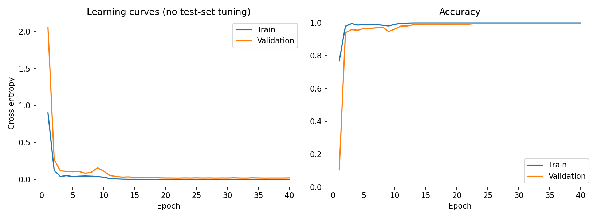
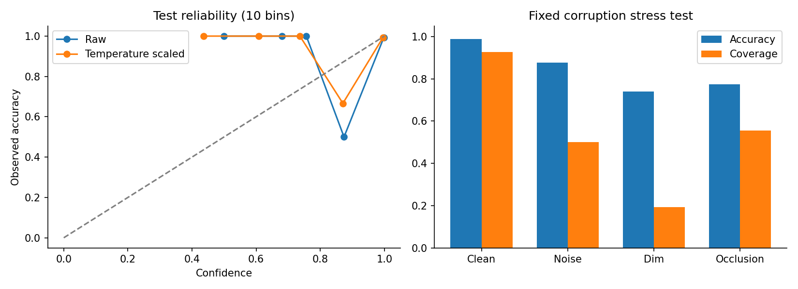
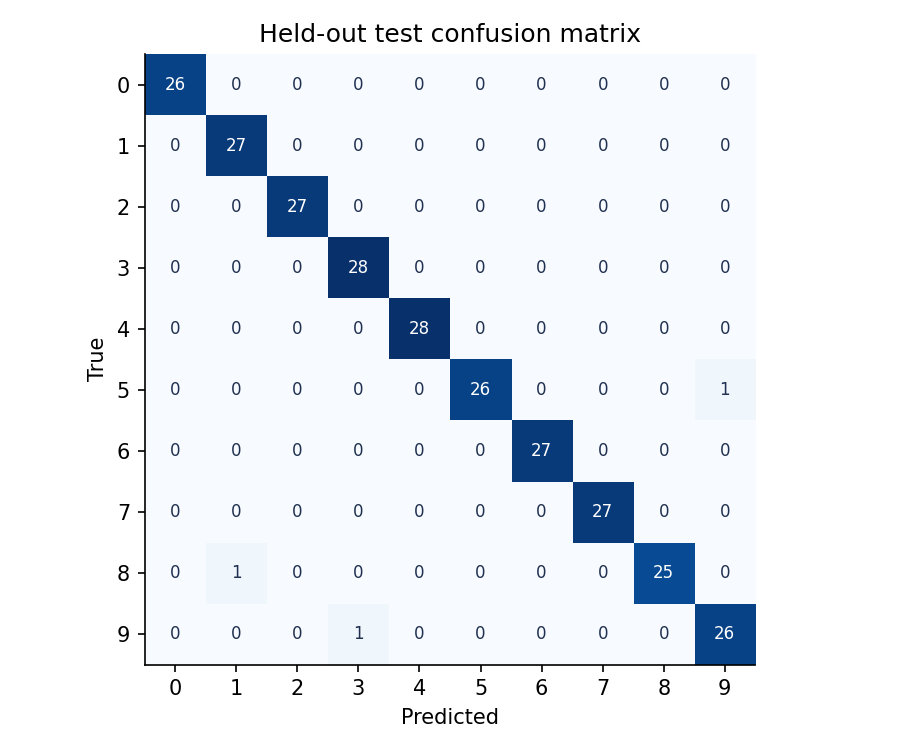
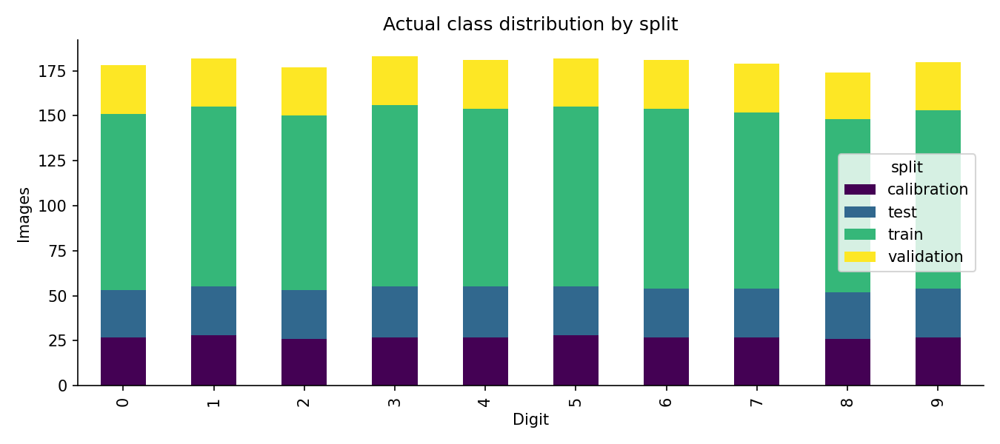

# 墨鉴：让数字识别的结果可以被检验

## 项目问题与定位

这个项目解决单张小尺寸手写数字图像的十分类问题。在完成手写 ResNet 的基础上，进一步回答：概率可信吗、什么情况下交给人复核、图像受损后表现如何、模型依赖哪些像素。项目定位为可复现的学习实验与本地演示服务，不是生产 OCR。

## 数据与方法

真实数据共 1797 张；缺失单元格 0，完全重复图像 0。图像由 0–16 归一化到 0–1。数据出处和授权见 REFERENCES.md。

固定种子 42；实际划分：训练 988，验证 269，校准 270，测试 270。逐行像素、标签与划分记录在 dataset.csv；全部索引和数据指纹保存在 manifest.json。

手写网络由 3×3 stem、三个阶段的六个残差块、全局平均池化和线性分类头组成。阶段宽度 16/32/64；后两阶段的首块通过 stride=2 降采样，并以 1×1 投影匹配 shortcut。没有使用预训练模型。

共有 174,970 个参数。训练 40 轮，AdamW 初始学习率 0.003，权重衰减 0.0001，余弦调度，batch size 64。按验证交叉熵选择第 22 轮。CPU 运行用时 20.1 秒（单次实测，不是性能基准）。

温度在独立校准集上从预定义的 [0.25, 4] 对数网格选择，得到 T=1.217004。同一校准集最大概率的 10% 分位数形成阈值 0.982715，目标是约 90% 校准集覆盖率。它不保证测试覆盖率或错误率。

## 实际实验结果

| 方法 / 场景 | 准确率 | Macro F1 | 覆盖率 | 接受样本准确率 |
|---|---:|---:|---:|---:|
| 逻辑回归基线（不拒识） | 94.81% | 0.9476 | 100.00% | 94.81% |
| ResNet + 温度校准 | 98.89% | 0.9889 | 92.59% | 99.60% |
| noise_sigma_0_25 | 87.78% | 0.8792 | 50.00% | 100.00% |
| brightness_0_5 | 74.07% | 0.7212 | 19.26% | 100.00% |
| center_occlusion | 77.41% | 0.7253 | 55.56% | 94.67% |

全体测试准确率的 95% Wilson 区间为 [96.78%, 99.62%]。这是二项比例近似区间；单个随机种子的结果不能说明跨划分稳定性。

测试 NLL：校准前 0.05394，校准后 0.05110；10 箱 ECE：校准前 0.01228，校准后 0.01070。温度不改变分类 argmax，因此不会改变总体准确率。校准效果必须按实测比较，不能假定一定变好。

扰动在同一保留测试集上生成：固定随机种子 43 的 σ=0.25 高斯噪声并裁剪到 [0,1]；亮度乘 0.5；中心 2×2 像素置零。这是指定扰动测试，不是自然分布外样本评估。

所有测试预测见 predictions.csv；错误预测单独保存在 errors.csv。不会删除失败结果，也不会只以接受样本的准确率代替总体准确率。

## 项目级创新

1. 可靠性闭环：独立校准、概率评价、拒识与覆盖率一起呈现。
2. 可见的模型敏感度：批量执行 64 次单像素置零，显示原预测类别概率的变化。它不是因果解释，也可能受扰动产生的分布变化影响。
3. 可追溯推理：每次返回请求 ID、真实服务端耗时与模型 SHA-256；启动时检查模型和评估报告是否匹配。
4. 可检查的交付：真实训练日志、逐样本预测、坏例、数据指纹、依赖锁与阶段性提交均保留。

以上是已有方法的工程组合创新，不宣称原创算法或超过未实际对比的项目。

## 后端设计与验证

FastAPI 在启动阶段只加载一次 CPU 模型。预测输入必须是 8×8、有限、介于 0 和 1 的数值矩阵，拒绝字符串、布尔值、错误形状、空白图像和超过 16 KiB 的请求体。训练产物通过允许列表展示。服务默认绑定 127.0.0.1，仅用于本地考核演示。

测试覆盖 shortcut 形状和梯度、完整模型反向传播、数据划分与重复检查、温度缩放性质、零接受样本指标、输入校验、真实 API 推理、体积限制及图表访问控制。具体通过情况以 artifacts/tests.txt 和 artifacts/demo/browser_checks.json 为准。

## 局限与诚实说明

- 仅 1797 张小图，单次样本级拆分，不代表跨书写者或真实文档上的效果。
- 浏览器新画或上传的图像有分布差异；没有真实标签就不计算其准确率。
- 概率阈值不是分布外检测器，错误预测仍可能有很高置信度。
- 未训练迁移学习模型、未做多种子或消融实验；不能声称这些实验已完成。
- CPU 耗时包含当前环境因素；不是并发吞吐量或生产性能承诺。
- 本项目由 AI 辅助完成，个人感悟和代码理解须由提交者本人补充与验证。

## 真实开发过程中的问题

本机系统 Git 因开发工具缺失无法运行，改用 Codex 自带 Git。官方 Python 包源发生连接中断，改用 HTTPS 镜像安装固定版本；NumPy 固定为 1.26.4，以兼容此 Intel Mac 可安装的 PyTorch 2.2.2。这些是本次实际遇到的工程问题，不是提交者个人学习经历。

本次训练开始 UTC：2026-10-26T11:51:05.270199+00:00；结束 UTC：2026-10-26T11:51:25.419368+00:00。模型 SHA-256：`b61fc5a50dd24098786e86bb9c83c874ce1ef77d9f0a8e026c75a0905f93c1c6`。

## 个人感悟（需本人完成）

请按 DEFENSE.md 提示，写下自己实际理解、修改、排错和验证的经历。此处保留待完成状态，不代写虚假个人成长记录。

## 交付验证结果

15 项自动化测试通过；保留 1 条上游依赖弃用提示，未隐藏。浏览器无脚本错误，390 像素宽度下无横向溢出。另行从权重重算全部 270 张测试预测，与记录一致（浮点指标以数值容差比较）。视频由真实 Chrome 页面连续采集，不含旁白。详见 artifacts/tests.txt、integrity-check.json 和 demo/browser_checks.json。
